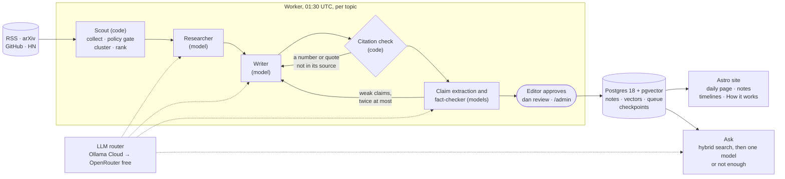

# Daily AI Notes

AI takes notes on what's happening, every day, on the things you care about.

Every night, LangGraph agents collect coverage for each topic in a fixed catalog, group reports of the same event into stories, research them, write short notes in which every sentence cites its sources, and fact-check every claim. A person approves each note before it is published. Visitors pick topics, read the day's notes and ask questions answered only from the notes, with citations, or told plainly that the notes don't cover it.

**Status:** a proof of concept ([ADR 0001](docs/adr/0001-proof-of-concept-scope.md)); the milestones and what each one waits for are in [INTENT.md](INTENT.md). The design and its trade-offs are in [docs/design.md](docs/design.md).

## How it works



- **Scout is code, not a model:** it fetches the topic's sources, keeps only what each publisher allows (full text, a summary, or a link), groups reports of one event by their vectors, and ranks stories by independent coverage.
- **Each picked story is its own LangGraph thread** with a Postgres checkpointer, so a note can wait for approval for days, and a run that stops resumes where it stopped.
- **Code checks before models check:** every sentence must cite a source that exists, and every number and quote must appear in it. Then a model from another family than the Writer's checks each claim; a factual claim needs two independent publishers, one of them trusted, or a primary source.
- **Ask is a pipeline, not an agent:** full-text and vector search over published notes, merged by reciprocal rank fusion. With no strong match it answers "Not enough in the notes" without calling a model.

## Eval results

The 30-question set in [`evals/`](evals/README.md) (40 fictional notes; 22 questions a note answers, 8 none does) runs on every pull request without a model:

| Score | Value |
| --- | --- |
| Expected note among Ask's sources (recall at 5) | 1.00 |
| Mean reciprocal rank of the expected note | 1.00 |
| "Not enough", with no model call, when no note covers the question | 1.00 |

The worker also runs it nightly with the Ask model and a judge from another model family; the How it works page shows the latest scores.

## Cost per day

$0. Models run on Ollama Cloud's free plan with OpenRouter's free models as the fallback, embeddings run locally (fastembed, `BAAI/bge-small-en-v1.5`), tracing uses Langfuse Cloud's free plan, and the router stops each provider at its daily limit. Every model call is recorded with its tokens in `llm_calls`; How it works shows calls, tokens and cost for the last 14 days.

## Development

Requires [uv](https://docs.astral.sh/uv/), Python 3.14, Node 24 or newer, and Docker.

```sh
uv sync
cp .env.example .env
uv run pre-commit install
(cd web && npx --yes pnpm@12.8.1 install)
make up      # Postgres 18 with pgvector, in Docker
make check   # format, lint, types, tests, and the site's checks (integration tests need `make up`)
make api     # the API on http://localhost:8000; try /api/v1/health
(cd web && npx --yes pnpm@12.8.1 dev)   # the site on http://localhost:4321, using `make api`
```

Every setting is listed, with what it does, in [`.env.example`](.env.example). After a change to the API, `make api-types` regenerates the site's typed client.

## Running the pipeline

```sh
uv run dan catalog sync              # load config/catalog.toml
uv run dan topics plan --all         # the Topic Planner proposes sources for each draft topic
uv run dan review list               # approve or reject: dan review approve plan-<id>
uv run dan edition run --all         # today's notes; each waits for dan review approve note-<id>
uv run dan ask "What changed in ..." # answered from published notes, with citations
uv run dan evals run                 # the 30-question eval (evals/README.md)
```

The model steps need `OLLAMA_API_KEY` or `OPENROUTER_API_KEY` in `.env`; `uv run dan llm probe` shows which models answer.

## Deploy

One VPS (Ubuntu 24.04, x86_64; 2 vCPU and 4 GB of memory are enough) runs everything with Docker Compose: a Cloudflare Tunnel, Caddy, the site, the API, the worker and Postgres. No container publishes a port: `cloudflared` connects out to Cloudflare, which holds the certificate and brings visitors to Caddy, so the stack can share a server with other services ([ADR 0002](docs/adr/0002-cloudflare-tunnel.md)). Each merge to `main` that passes CI builds the two images, pushes them to GHCR and runs [`deploy/deploy.sh`](deploy/deploy.sh) on the server over SSH. That script pulls the image, migrates the database, starts the stack, reloads Caddy's config, checks `/api/v1/health` through Caddy, and redeploys the previous image if any step fails.

### Server setup, once

As root, on a fresh server; on one that already runs other services, skip what it has:

```sh
# Docker Engine and Compose, from Docker's apt repository (docs.docker.com/engine/install/ubuntu)
apt update && apt install -y ca-certificates curl
install -m 0755 -d /etc/apt/keyrings
curl -fsSL https://download.docker.com/linux/ubuntu/gpg -o /etc/apt/keyrings/docker.asc
chmod a+r /etc/apt/keyrings/docker.asc
tee /etc/apt/sources.list.d/docker.sources <<EOF
Types: deb
URIs: https://download.docker.com/linux/ubuntu
Suites: $(. /etc/os-release && echo "${UBUNTU_CODENAME:-$VERSION_CODENAME}")
Components: stable
Architectures: $(dpkg --print-architecture)
Signed-By: /etc/apt/keyrings/docker.asc
EOF
apt update && apt install -y docker-ce docker-ce-cli containerd.io docker-buildx-plugin docker-compose-plugin

# Security updates install themselves
apt install -y unattended-upgrades && dpkg-reconfigure -f noninteractive unattended-upgrades

# Firewall: SSH only. Visitors arrive through the tunnel, which connects out.
ufw allow OpenSSH && ufw enable

# 2 GB of swap, so a spike during the nightly run cannot get containers killed for memory
fallocate -l 2G /swapfile && chmod 600 /swapfile && mkswap /swapfile && swapon /swapfile
echo '/swapfile none swap sw 0 0' >> /etc/fstab

# The deploy user and the app folder. Membership of the docker group is root-equivalent:
# guard this user's keys.
adduser --disabled-password --gecos "" deploy && usermod -aG docker deploy
install -d -o deploy -g deploy -m 700 /srv/dailyainotes /srv/dailyainotes/backups
install -d -o deploy -g deploy -m 700 /home/deploy/.ssh
# Put your public key and the deploy workflow's public key in /home/deploy/.ssh/authorized_keys.

# SSH: keys only. Root keeps key login: `PermitRootLogin no` would lock out a root-only login.
tee /etc/ssh/sshd_config.d/10-hardening.conf <<EOF
PermitRootLogin prohibit-password
PasswordAuthentication no
KbdInteractiveAuthentication no
EOF
systemctl reload ssh
```

Then write `/srv/dailyainotes/.env`, owned by `deploy`, mode 600. It takes the settings in [`.env.example`](.env.example) except three that are not the server's: `DATABASE_URL` (Compose builds it), `EMBEDDING_CACHE_DIR` (the image holds the model) and `GIT_SHA` (Compose sets it). Add:

```sh
IMAGE=ghcr.io/<owner>/dailyainotes   # lower case
DOMAIN=dailyainotes.com
POSTGRES_PASSWORD=                   # openssl rand -hex 32
CF_ACCESS_TEAM_DOMAIN=               # <team>.cloudflareaccess.com, below
CF_ACCESS_AUD=                       # the Access application's AUD tag, below
RESEND_API_KEY=                      # reader sign-in emails, below
TURNSTILE_SITE_KEY=                  # the sign-in form's bot check, below
TURNSTILE_SECRET_KEY=
IP_HASH_KEY=                         # openssl rand -hex 32
TUNNEL_TOKEN=                        # from Cloudflare, below
```

### Cloudflare Tunnel

The domain's DNS must be on Cloudflare; the free plan is enough. In the dashboard, under Networking, Tunnels, create a tunnel and put its token in `.env` as `TUNNEL_TOKEN`. Add two published application routes, the domain and `www.` before it, both with the service URL `http://caddy:80`; Cloudflare creates their DNS records, so delete any A or AAAA records for those names first. Turn on Always Use HTTPS (SSL/TLS, Edge Certificates). Caddy sends `www` to the bare domain, and passes Cloudflare's `CF-Connecting-IP` to the API as the visitor's address, which Ask's rate limits use.

### Cloudflare Access for /admin

The editor signs in through Cloudflare Access ([ADR 0003](docs/adr/0003-sign-in-and-reader-accounts.md)); its free plan is enough. In the Zero Trust dashboard, choose a team name, then under Access, Applications, add a self-hosted application with two destinations, `<domain>/admin` and `<domain>/api/v1/admin`, and a policy that allows only the editor's email; the one-time PIN login sends a code by email. Put the team domain (`<team>.cloudflareaccess.com`) in `.env` as `CF_ACCESS_TEAM_DOMAIN` and the application's AUD tag as `CF_ACCESS_AUD`. The API checks Access's signed token on every admin request; without these two settings admin is off, and `dan review` on the server still works.

### Reader sign-in

Readers sign in with a code sent by email ([ADR 0003](docs/adr/0003-sign-in-and-reader-accounts.md)); sign-in stays off until `RESEND_API_KEY` is set. On Resend's free plan (3,000 emails a month, 100 a day), add the domain, put the DNS records it shows (SPF and DKIM) in Cloudflare, and add a DMARC record (`_dmarc`, `v=DMARC1; p=none;`). Create an API key with sending access only. `EMAIL_FROM` must use the verified domain. For the bot check, add a Turnstile widget for the domain in Cloudflare's dashboard and put its two keys in `.env`; without them the form has no bot check. Compose sets `SITE_URL` from `DOMAIN`.

### GitHub settings

- Secret `DEPLOY_HOST`: the server's address. A secret, not a variable, so it stays out of the public CI logs. Until it is set, CI builds and pushes images and skips the deploy steps.
- Secret `DEPLOY_SSH_KEY`: a private key made only for deploys (`ssh-keygen -t ed25519 -f deploy_key -N ""`), whose public half is in `deploy`'s `authorized_keys`.
- Secret `DEPLOY_KNOWN_HOSTS`: the output of `ssh-keyscan -t ed25519 <server>`.
- After the first push, make the `dailyainotes` and `dailyainotes-web` packages public in their GHCR settings, so the server pulls without a token. Otherwise, run `docker login ghcr.io` as `deploy` with a token that can only read packages.

### First run on the server

Commands run in the worker's container, which has the most memory. In `/srv/dailyainotes`:

```sh
alias dan='TAG=$(cat .deployed) docker compose -f compose.prod.yml exec worker dan'
dan catalog sync
dan topics plan --all && dan review list
```

The worker runs every active topic's edition at 01:30 UTC; `dan review list` shows the notes waiting for approval.

### Backups

`backup.sh` dumps the database into `backups/` and keeps the newest 7. Schedule it with `crontab -e` as `deploy`:

```cron
30 0 * * * /srv/dailyainotes/backup.sh >> /srv/dailyainotes/backups/backup.log 2>&1
```

`./restore-check.sh` restores the newest dump into a scratch database, prints what it holds and drops it; run it after the first backup and now and then. To restore the live database from a dump:

```sh
export TAG=$(cat .deployed)
docker compose -f compose.prod.yml stop api worker
docker compose -f compose.prod.yml exec -T db dropdb -U dan dailyainotes
docker compose -f compose.prod.yml exec -T db createdb -U dan dailyainotes
docker compose -f compose.prod.yml exec -T db pg_restore -U dan -d dailyainotes --no-owner < backups/<file>.dump
docker compose -f compose.prod.yml start api worker
```

To go back to an earlier release, run `./deploy.sh <commit sha>`. Logs: `TAG=$(cat .deployed) docker compose -f compose.prod.yml logs -f worker`.

## Next steps

Deferred by [ADR 0001](docs/adr/0001-proof-of-concept-scope.md) and still open after [ADR 0003](docs/adr/0003-sign-in-and-reader-accounts.md), in rough order:

- Custom topics written by readers themselves, beyond suggestions the editor accepts.
- A per-reader preference memory fed by "more like this" and "less like this" (accounts came first, ADR 0003).
- A daily email of the reader's notes.
- A full review UI: request a rewrite, edit a draft, review topic plans in the browser.
- An MCP server with `search_notes`, `get_note` and `list_topics`.
- Offsite backups, uptime monitoring and alerts.

## How this repository is run

- [AGENTS.md](AGENTS.md): how humans and coding agents work here
- [INTENT.md](INTENT.md): rules and standing tasks
- [MEMORY.md](MEMORY.md): what has been learned, with sources
- [DESIGN.md](DESIGN.md): the visual system

## License

[Apache-2.0](LICENSE)
